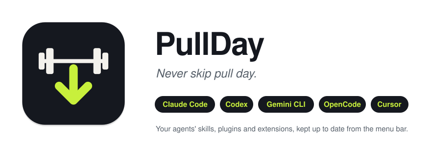

<p align="center">
  <picture>
    <source media="(prefers-color-scheme: dark)" srcset="assets/hero-dark.svg">
    
  </picture>
</p>

<p align="center">
  <a href="https://github.com/SherifMoShalaby/PullDay/releases/latest"></a>
  
  
  
  
  
</p>

---

Monday you clone a skill. Tuesday you add a plugin marketplace. Wednesday your agent suggests a CLI tool and you `uv tool install` it. Three weeks later half of them are behind, a few have fixes you never got, and you no longer remember what you installed or where.

**PullDay** lives in your menu bar and remembers for you. It finds every skill, plugin, extension and tool your AI coding agents use, checks them on a schedule, and tells you what's behind. One click updates them, or you can let it update them on its own.

PullDay is an independent project. It is not affiliated with or endorsed by Anthropic, OpenAI or Google.

## How it works

1. **Discover.** On launch, on a schedule, and whenever a skills folder changes, PullDay looks in each agent's folders and your package managers for what's installed.
2. **Check.** It asks each source whether there's something newer: `git fetch` for cloned skills, `git ls-remote` for snapshot marketplaces, the package manager's own "outdated" list for tools, and Homebrew, npm and GitHub for version numbers. Checking never installs or changes anything.
3. **Update.** You click **Update**, an agent's **Update all**, or the global **Update All**. With automatic updates on, scheduled checks install updates by themselves. Every command and its output goes to the log.

The menu groups everything by agent. A shared skills folder like `~/.agents/skills` shows up under every agent that reads it, and tools no agent loads directly are listed under **Other**.

## What it keeps up to date

| Agent | Source | How it's found | How it's updated |
| --- | --- | --- | --- |
| Claude Code | Plugin marketplaces | `~/.claude/plugins/marketplaces/*` | `claude plugin marketplace update`, then `claude plugin update` for each installed plugin |
| Claude Code | The `claude` command | `command -v claude` | `brew upgrade --cask claude-code` for a Homebrew install, otherwise `claude update` |
| Codex | Plugin marketplaces | `~/.codex/.tmp/marketplaces/*` | `codex plugin marketplace upgrade` |
| Codex | The `codex` command | `command -v codex` | `codex update` |
| Gemini CLI | Extensions | `~/.gemini/extensions/*` | `gemini extensions update` |
| Antigravity | Plugins installed from a git repo | `agy plugin list` | `agy plugin install <repo>` again, which updates it in place |
| Antigravity | The `agy` command | `command -v agy` | `agy update` |
| All | Git-cloned skills | Git repos in `~/.claude/skills`, `~/.agents/skills`, `~/.gemini/skills`, `~/.config/opencode/skills`, `~/.cursor/skills` (symlinks followed) | `git pull --ff-only` |
| Any | uv tools, e.g. graphify | `uv tool list` | `uv tool upgrade` |
| Any | pipx tools | `pipx list --short` | `pipx upgrade` |
| Any | npm globals (off by default) | `npm ls -g` | `npm install -g <name>@latest` |

Each source can be turned off in **Settings → Sources**, which also shows which agents were found on your Mac. An agent that isn't installed costs nothing: its folders are simply empty.

Some tools ship their skill separately from the CLI. graphify is one: upgrading the package doesn't refresh its copy in `~/.claude/skills`, so PullDay runs `graphify install` after graphify updates. You can add a post-update command like that to any item in **Settings → Items**.

## Install

**Download:** get `PullDay-<version>.dmg` from the [latest release](https://github.com/SherifMoShalaby/PullDay/releases/latest), open it and drag PullDay to Applications. Builds aren't notarized yet, so macOS blocks the app the first time: try to open it once, then click **Open Anyway** in **System Settings → Privacy & Security**. Or run:

```bash
xattr -dr com.apple.quarantine /Applications/PullDay.app
```

**Or build it yourself.** You need macOS 13 or later and the Xcode Command Line Tools (`xcode-select --install`). The full Xcode app isn't required, and there are no dependencies to fetch.

```bash
git clone https://github.com/SherifMoShalaby/PullDay.git
cd PullDay
./build.sh --install
```

That compiles a universal app, copies it to `/Applications` and launches it. Either way, look for the barbell in your menu bar. Then:

- Allow notifications when macOS asks, so you hear about updates.
- Turn on **Settings → General → Open PullDay at login** so it keeps running.

`./build.sh` alone only builds `build/PullDay.app`.

<details>
<summary><strong>Sharing a build with another Mac</strong></summary>

`./build.sh --dmg` makes `build/PullDay.dmg`. It's ad-hoc signed by default, so another Mac blocks it the first time, just like the release download above. With an Apple Developer ID, `SIGN_IDENTITY="Developer ID Application: …"` signs the build, and `NOTARY_PROFILE=<profile>` (from `xcrun notarytool store-credentials`) also notarizes and staples the DMG, so it opens without warnings.

</details>

## Using it

- Click the barbell to see everything PullDay found. A number next to it means updates are waiting.
- **Update** updates one item. An agent's **Update all** updates that agent's items, and **Update All** at the top updates everything.
- The **⋯** menu on each row has:
  - **Update Now**, which runs even if no update was detected;
  - **Skip This Update**, which hides this update until a newer one appears (**Stop Skipping** undoes it);
  - **Show in Finder**;
  - **Post-Update Command…** and **Show Log**;
  - **Ignore**.
- **Settings → General**: how often to check (daily by default), whether to install updates automatically (off by default), notifications, and opening at login.
- **Settings → Sources**: which agents were found, and which sources to check.
- **Settings → Items**: ignore items, or add a command to run after an item updates.
- **Log**: every command PullDay ran, with its output. It's also saved to `~/Library/Logs/PullDay.log`.

After a plugin or extension updates, restart that agent's open sessions to load the new version.

## What it runs on its own

PullDay runs commands on your machine, so here is exactly what it does unasked:

- **Checks**, on the schedule you pick and when a skills folder changes. They only read: `git fetch`, `git ls-remote`, `uv tool list --outdated`, `pipx runpip … list --outdated`, `npm outdated -g`, and version lookups on formulae.brew.sh, registry.npmjs.org and the GitHub API.
- **Updates** happen only when you click, unless you turn on **Install updates automatically**. It's off by default.
- A git repo that a skills folder only links to, such as one of your own projects, is never updated on schedule, only when you click.
- Git never runs a repository's hooks and never follows `file://` remotes. Nothing ever answers a password or consent prompt for you: a private repo that needs credentials shows an error, and a Gemini extension update that needs your consent asks you to run it in a terminal.
- Commands run through your login shell (`$SHELL -l`, or zsh if your shell isn't POSIX, such as fish), with a timeout, and with Homebrew, `~/.local/bin`, `~/.claude/local` and nvm's Node added to `PATH`.

## Good to know

- If a tool isn't found, make sure it's on your `PATH` in `~/.zprofile`, not just `~/.zshrc`.
- Detecting uv updates needs a uv recent enough for `uv tool list --outdated`. With an older uv, items show "Can't check", but **Update Now** still works.
- Gemini CLI now serves Gemini Code Assist Standard and Enterprise and paid API keys; Google moved everyone else to Antigravity CLI (`agy`). PullDay covers both. Antigravity plugins installed from a marketplace rather than a git repo show "Not installed from a git repo".
- Claude Code can auto-update third-party marketplaces itself (`/plugin` → Marketplaces). PullDay works either way and also covers skills that aren't plugins.
- GitHub's API allows 60 unauthenticated requests an hour. Gemini extensions installed from GitHub releases show "Couldn't check" when that runs out.
- A Claude Code plugin's "update available" comes from its marketplace being behind. If the marketplace is current but an installed plugin is stale, use **Update Now**.
- pipx checks run one `pipx runpip` per tool, which is slower with many tools. npm is off by default because it lists every global package.

## Uninstall

1. Turn off **Settings → General → Open PullDay at login**, then choose **Quit** in the menu.
2. Delete `/Applications/PullDay.app`.
3. Optionally, remove its settings and log:

```bash
defaults delete dev.pullday.app
rm -f ~/Library/Logs/PullDay.log
```

Nothing else was installed. Your skills, plugins and tools stay exactly as they are.

## Contributing

Issues and pull requests are welcome. The app is about 2,000 lines of Swift with no dependencies, built with one `swiftc` call, and `./build.sh --test` runs a self-test that needs no network. [CONTRIBUTING.md](CONTRIBUTING.md) explains how the code is laid out and how to add a new agent or source, and [RELEASING.md](RELEASING.md) how a release is cut.

Found a security problem? Please follow [SECURITY.md](SECURITY.md) instead of opening a public issue.

## License

[MIT](LICENSE)
